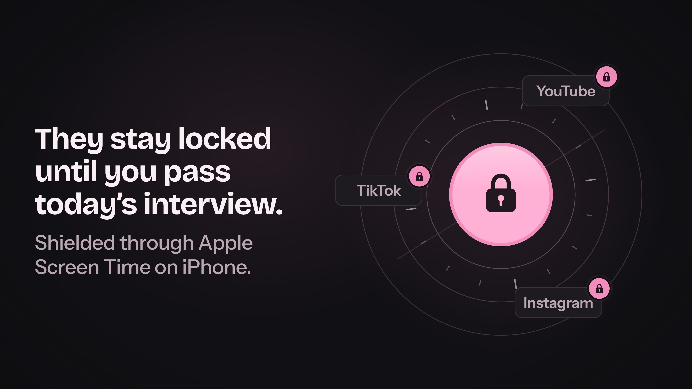
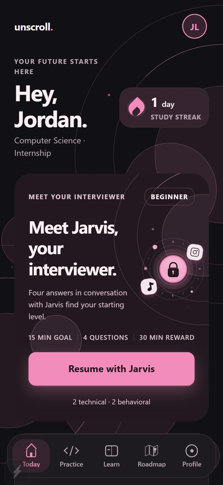
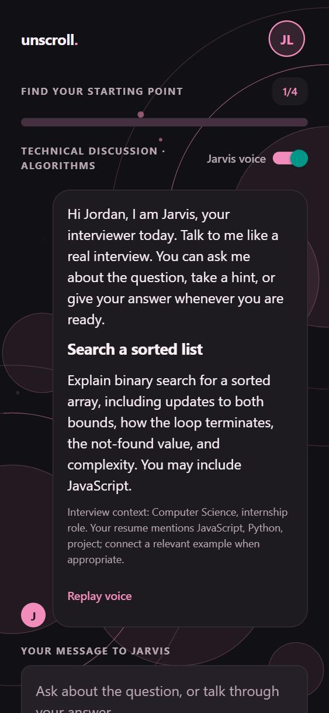
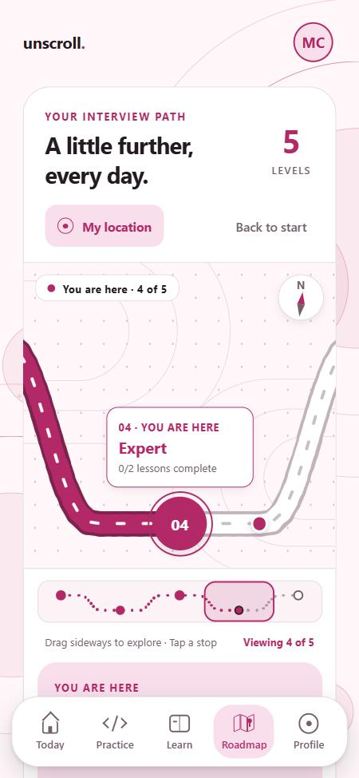

# Unscroll.

**Less scrolling. More becoming.**

Unscroll swaps your next scroll for a short interview with Jarvis, an AI interviewer, and gives you a break when you pass.

[The film](#the-film) · [What it is](#what-it-is) · [Highlights](#highlights) · [Run the demo](#run-the-demo) · [AI and voice](#ai-and-voice-all-on-free-tiers) · [How it is built](#how-it-is-built) · [Honest limits](#honest-limits)

## The film

[](docs/media/unscroll-ad.mp4)

The launch film was drawn and scored entirely in code: eight scenes built with Remotion and a synthesised soundtrack, all in [marketing/ad](marketing/ad).

## What it is

1. **Pick your distractions.** Choose the apps that pull you in, then tell Unscroll your major, whether you are aiming for an internship or a full-time job, and up to five target companies. Add your resume as a PDF or text file, or paste it.
2. **Pass a short interview with Jarvis.** A placement interview sets your starting level, and the daily interview adapts to it. Ask Jarvis to clarify, take a hint if you are stuck, answer by typing or speaking, and read the feedback. A failed answer is not skipped: you review the feedback and answer a different question of the same kind.
3. **Earn your break.** Finish the required questions and you earn a window of time with the apps you chose. In Expo Go that window is practice mode only; blocking the apps needs the native iPhone build (see [Honest limits](#honest-limits)).

## Highlights

<table>
  <tr>
    <td align="center" valign="top" width="25%"><br><b>Today</b><br>Start the day's interview and see your streak.</td>
    <td align="center" valign="top" width="25%"><br><b>Jarvis</b><br>Ask, take a hint, answer by typing or voice.</td>
    <td align="center" valign="top" width="25%"><br><b>Roadmap</b><br>A road you drag across five levels.</td>
  </tr>
</table>

- **Jarvis, a conversation with voice.** Jarvis greets you, asks the question, and answers follow-ups. Jarvis speaks with a Groq voice when a Groq key is set and with the phone's own voice otherwise. You can record an answer, edit the transcript, and send it.
- **STAR feedback.** Behavioral answers are scored on Situation, Task, Action and Result, using evidence from your own answer.
- **Hints that cost evaluation points.** Each hint takes 10 points off that answer's evaluation, up to 3 hints. Pass, fail and unlock still use the raw grade.
- **Three skill standings.** Communication, Technical discussion and Coding each get a standing that follows roughly your last five graded answers.
- **Adaptive daily interview and placement.** Placement sets your level; the daily interview follows it.
- **No skipping a failed answer.** Read the feedback, then answer a different question of the same kind.
- **Eight lessons** with coaching and a knowledge check each. Coaching explains the idea and never completes the check.
- **A draggable road map** through five levels (Beginner, Intermediate, Advanced, Expert, Master), with the lessons along the way.
- **Streak** and study minutes, so the daily habit is visible.
- **Themes.** Light, Dark or System, with Pink, Red, Blue or Green accents.
- **Personalised** from your major, your resume and your target companies. Companies are context for the coaching, not a claim about what an employer will ask.

## Run the demo

This runs the app on an iPhone in Expo Go, with the server on your computer. Windows works the same way as a Mac; only the copy command differs.

**You need**

- Node.js 24 and git. `npm run check:environment` fails on any other major version of Node.
- An iPhone with Expo Go from the App Store. The installed Expo Go must support Expo SDK 57.
- The iPhone and the computer on the same Wi-Fi.
- An NVIDIA key and a Groq key for the full experience. Neither is in this repository, on purpose. Ask Charles for the team keys privately, or create free ones: [docs/NVIDIA.md](docs/NVIDIA.md) and [docs/GROQ-HACKATHON.md](docs/GROQ-HACKATHON.md). Without keys the app still runs in rubric mode.

**Steps**

1. Clone the repository.

   ```bash
   git clone https://github.com/Charlesganu2004/Whitman-Hackathon.git
   cd Whitman-Hackathon
   ```

2. Install the packages. The optional second command prints PASS when Node and SQLite are ready.

   ```bash
   npm install
   npm run check:environment
   ```

3. Create `.env` and paste the keys. On Windows, use `copy .env.example .env`.

   ```bash
   cp .env.example .env
   ```

   Open `.env` and fill in the lines below. Remove the `#` in front of `AI_PROVIDER=nvidia`: with both keys set and no `AI_PROVIDER`, the server grades with Groq first.

   ```dotenv
   NVIDIA_API_KEY=your_nvidia_key
   GROQ_API_KEY=your_groq_key
   AI_PROVIDER=nvidia
   ```

   `.env` is ignored by git, so every computer that runs the server needs its own copy. Never commit it, never paste a key into chat or a pull request, and never put a key in an `EXPO_PUBLIC_` variable. If you run `npm run demo` before this step, it creates `.env` from the example for you; add the keys and run it again.

4. Start the API and Expo together. The terminal prints whether AI feedback is on and the address your phone will use.

   ```bash
   npm run demo
   ```

5. Scan the QR code with the iPhone Camera and open it in Expo Go. The app finds your computer by itself.

6. Tap **Create account**. A new account goes straight into onboarding. Use fictional details: in AI mode your answers and resume text are sent to the AI provider.

No iPhone? Run `npm run server` in one terminal and `npm run web` in another, then open `http://localhost:8081/iphone.html` to see the app inside an iPhone frame.

The full guide is in [docs/DEMO.md](docs/DEMO.md).

**If it does not connect**

- Put the phone and the computer on the same Wi-Fi. Guest and public networks often isolate devices; a private hotspot works.
- On the iPhone, open Settings, then Expo Go, and turn on Local Network. Without it the phone cannot reach your computer.
- Allow incoming connections for `node` when macOS or Windows asks. If you dismissed the prompt, allow it in the firewall settings.
- Open `http://<computer address>:3001/health` in the phone's browser, using the address `npm run demo` printed. A JSON reply with `"ok":true` means the network is fine.
- Do not use an Expo tunnel. It forwards the app bundle but not the API.
- When the server cannot be reached, sign-in shows an error and the login screen has a **Server connection** panel where you can enter the computer's address and tap **Test connection**. If you are already signed in with saved data, the app shows "Offline view. Reconnect before starting or submitting practice." with a **Reconnect** button, and starting practice is disabled until the server answers.
- If the terminal says "AI feedback: off", the server found no usable key. Check that `.env` sits in the repository root, then stop `npm run demo` and start it again.

## AI and voice, all on free tiers

| Job | Provider | Model | Measured |
|---|---|---|---|
| Grading, hints and Jarvis's replies | NVIDIA hosted API, free | `nvidia/nemotron-3-super-120b-a12b` | Live replies validated in 1.6 to 2.6 s |
| Speech to text for recorded answers | Groq, free tier | `whisper-large-v3-turbo` | A test sentence transcribed word for word in about 0.5 s |
| Jarvis's voice | Groq, free tier | `canopylabs/orpheus-v1-english` | Speech returned in 0.5 to 1.0 s |
| Fallback voice | The phone's built-in voice (`expo-speech`) | none | Used when there is no Groq key or Groq errors |

Measured on 2026-10-10 on one development machine, so treat these as a snapshot, not a promise. Four other candidate models were tried and passed over: they were slower (5.4 s and 18 s) or timed out at 35 s.

- NVIDIA cannot transcribe audio, so recorded answers need a Groq key (an OpenAI key also works). Typed answers and keyboard dictation need neither.
- Orpheus accepts 200 characters per request and has a small daily quota. The server sends long text in pieces and the app caches the audio for each question. Accept the model terms once in the Groq console, or the phone's voice is used.
- No key at all: rubric practice still works. Grading, hints and Jarvis's answers come from the built-in rubric, nothing is sent to an AI provider, and the app labels that feedback "Rubric feedback" instead of AI feedback.
- OpenAI is supported as another provider if you bring your own key. It is not part of the demo setup. The environment variables are listed in [.env.example](.env.example).
- Run `npm run check:ai` to make one live grading call with fictional data. It prints the provider, model and latency, and never prints a key. With no key it says rubric mode is active and sends nothing.

## How it is built

**Stack.** Expo SDK 57, React Native 0.86, React 19.2, react-native-web 0.21 and TypeScript for the app. A Node 24 server on `node:http` with the built-in `node:sqlite`, so there is no database to install. Resume PDFs are read with `unpdf`.

**Where things live**

```text
App.tsx                    App shell: sign-in, onboarding, tabs, practice flow
src/core/                  Pure logic, no React: engine.ts (sessions, placement, streaks,
                           lessons), skills.ts (standings, hint cost), roadmap.ts,
                           interview.ts, draft.ts, content.ts (questions and lessons)
src/ui/                    Screens and components, including InterviewChat.tsx,
                           JourneyMap.tsx and SkillStandings.tsx
src/services/              api.ts (finds the server), voice.ts, cache.*.ts, focus.ts
server/                    app.mjs (routes), ai.mjs (providers), index.mjs (start),
                           resume.mjs and pdf-worker.mjs
modules/interview-focus/   Local Expo module and Swift extension for Apple Screen Time
marketing/ad/              The launch film, a Remotion project (see SCRIPT.md there)
public/                    iphone.html, the iPhone frame for desktop previews
scripts/                   dev.mjs, check-ai.mjs, check-environment.mjs
tests/                     node:test files
docs/                      Guides and notes
```

**Data.** The server stores accounts (with salted password hashes), session tokens, profiles, resume text, interviews, lessons and study history in `server/data/interview.sqlite`, which git ignores. On the phone, the app keeps a cache in Expo SQLite and the sign-in token in SecureStore. The browser build uses browser storage.

**Commands**

```bash
npm test                   # deterministic tests, no network, no live AI (163 passing)
npm run typecheck          # tsc --noEmit
npm run check:ai           # one live grading call with fictional data
npm run check:environment  # Node 24 and SQLite check
npm run server             # the API alone, on port 3001
npm run export:web         # export the web bundle
npm run export:ios         # export the iOS JavaScript bundle
```

GitHub Actions runs the typecheck, the tests, both exports and the native-config checks on every push (`.github/workflows/verify.yml`). See [docs/TESTING.md](docs/TESTING.md) for the manual acceptance cases.

**The film**

```bash
cd marketing/ad
npm install
npm run studio             # preview and scrub the film
npm run render:hd          # 1080p to out/unscroll-ad-1080p.mp4
npm run render             # 4K master to out/unscroll-ad-4k.mp4
npm run audio              # rebuild the soundtrack
```

It is authored at 1920 by 1080 and 60 fps. The 4K master stays out of git; the 1080p copy is in `docs/media`.

## Honest limits

- **Expo Go is practice mode.** It cannot block other apps. Shielding needs the signed native iPhone build with Apple Screen Time, and that build has not been tested on a device. See [docs/IPHONE.md](docs/IPHONE.md).
- **Student code is reviewed, never executed.** Coding answers get static and AI review. There is no code judge.
- **NVIDIA's free access is rate limited.** Its trial terms cover evaluation and prototyping, not a public launch.
- **Keys are never committed.** They live only in the server's `.env`, which git ignores, so each computer that runs the server needs its own `.env`.
- **15 high-severity `npm audit` entries** sit in transitive Expo and Metro packages, and no compatible patch exists yet.
- **Local setup only.** The server speaks plain HTTP on a private network. A public deployment needs HTTPS, a privacy policy, terms and an account review.
- **Built, with automated tests; phone checks still to do:** saving the typed answer on Save and leave, the end-of-session recap, the earned-break start guard, missed-answer feedback in the recap, and the offline banner with automatic retry.

Practice here is preparation, not a guarantee of correct code or a job offer. What is left, including device testing, an accessibility audit and live provider testing, is tracked in [docs/TODO.md](docs/TODO.md).

## Team and credits

Unscroll was built at the Whitman Hackathon. Charles led the product scope and built the first version; his contribution and the hand-off notes are in [docs/TEAM-HANDOFF.md](docs/TEAM-HANDOFF.md).

- The interface draws layout inspiration from the requested iOS galleries. See [docs/DESIGN.md](docs/DESIGN.md).
- The [REA repository](https://github.com/morluto/rea) informed the structure, network and screenshot inspection method. Its code was not installed or executed.
- The [Master Repo skills](https://github.com/Charlesganu2004/Master-Repo-Use) guided architecture, design, review and verification, and the [local-index benchmark](https://charlesganu2004.github.io/Global-Ai-Setup-Benchmark/) informed local retrieval.
- The Learn tab links to [NeetCode](https://neetcode.io/roadmap), [LeetCode study plans](https://leetcode.com/studyplan/) and [HackerRank](https://www.hackerrank.com/dashboard). Unscroll's own question bank and worked examples are original.
- Reviewed commits, PDF extraction boundaries and dependency advisories are in [docs/INTAKE.md](docs/INTAKE.md).
